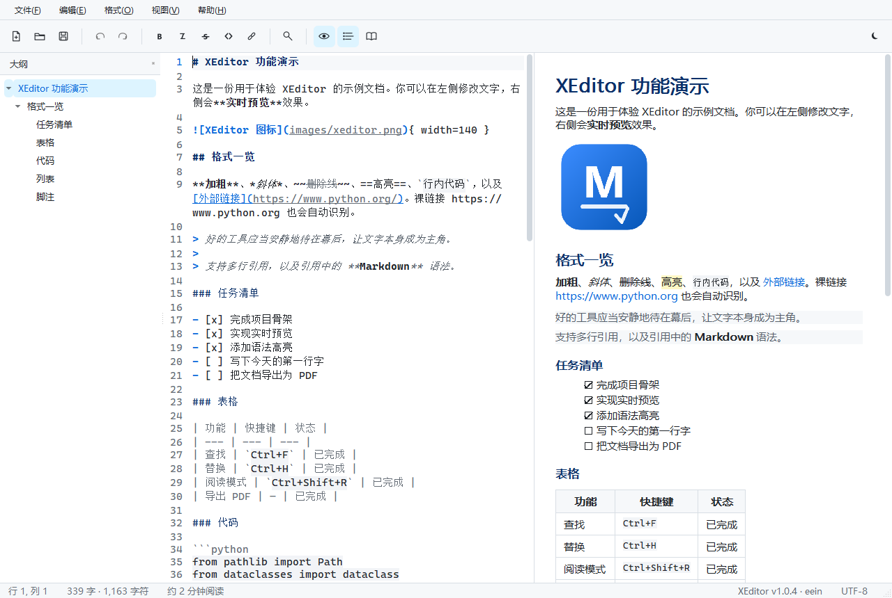
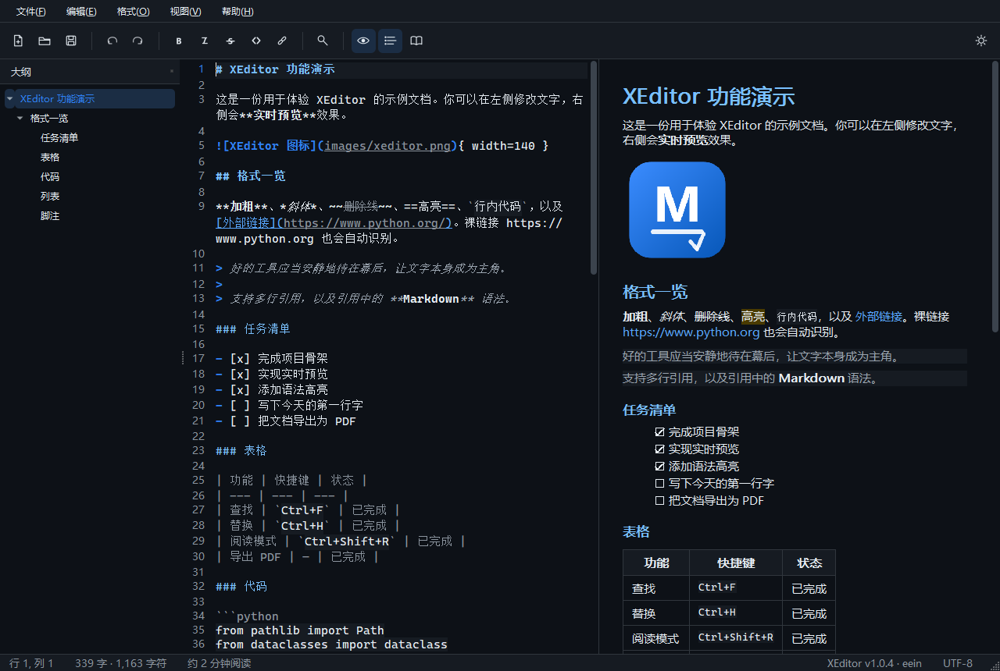

# XEditor

<p align="center">
  
</p>

<p align="center">
  <b>一款轻量的 Markdown 阅读与编辑器</b><br>
  Python + PySide6 · 本地优先 · 实时预览
</p>

<p align="center">
  <b>版本 1.0.4</b> &nbsp;·&nbsp; 作者：eein &nbsp;·&nbsp;
  联系邮箱：<a href="mailto:eein@163.com">eein@163.com</a>
</p>

XEditor 使用 Python 与 PySide6 编写，面向日常的 Markdown 阅读和写作。左侧编辑、右侧实时预览，支持大纲导航、语法高亮、查找替换、双主题、沉浸式阅读以及 HTML / PDF 导出。所有内容都在本地处理，不需要联网。

## 功能特性

- **实时预览**：边写边看，支持标题锚点、表格、任务列表、脚注、删除线、围栏代码块等常用 Markdown 扩展。
- **Markdown 语法高亮**：标题、强调、链接、引用、列表、代码块分别着色，带行号与当前行提示。
- **代码高亮**：基于 Pygments，内置浅色与深色两套配色。
- **标题大纲**：自动解析标题层级，点击即可跳转到对应章节。
- **查找 / 替换**：支持区分大小写、全词匹配、正则表达式、全部替换与匹配高亮。
- **双主题**：浅色 / 深色 / 跟随系统，可随时切换。
- **阅读模式**：`Ctrl+Shift+R` 隐藏编辑区，专注阅读。
- **导出**：导出为独立 HTML（图片内嵌为 Base64）或 PDF。
- **文件处理**：自动保存（可开关，针对已有文件）、最近文件、拖拽打开、命令行打开；自动识别 UTF-8 / UTF-8 BOM / GB18030 / Big5，保留原换行符与编码。
- **编辑体验**：自动延续列表/引用、Tab 缩进、快捷键插入格式、自定义编辑器字体、`Ctrl+滚轮` 缩放。
- **安全渲染**：过滤 `<script>`、`<iframe>`、事件处理器、`javascript:` 等危险 HTML；裸 `http(s)://` 与 `www.` 链接自动识别。
- **状态栏**：行列位置、字数、字符数、预计阅读时间与文件编码。
- **可持久化**：窗口布局、主题、字体、大纲宽度和最近文件会被记住。
- **单实例启动**：重复打开会激活已运行窗口，避免单文件版重复解压 Qt DLL 导致冲突；带文件参数启动时会转发给现有窗口打开。

## 截图

| 浅色主题 | 深色主题 |
| --- | --- |
|  |  |

| 查找 | 阅读模式 |
| --- | --- |
|  |  |

## 环境要求

- Python **3.10+**
- PySide6 **6.6+**
- Python-Markdown **3.5+**
- Pygments **2.16+**

开发环境为 Windows 11 + Python 3.12 + PySide6 6.7.2；代码本身可运行于 Linux 与 macOS，字体和快捷键会自动回退。

## 安装与运行

```powershell
# 在项目目录中
python -m venv .venv
.venv\Scripts\activate
pip install -r requirements.txt

# 启动
python main.py

# 或者
python -m xeditor

# 直接打开某个文件
python main.py samples\demo.md
```

也可以作为包安装：

```powershell
pip install -e .
xeditor samples\demo.md
```

## 使用说明

- **打开文件**：`文件 → 打开`、`Ctrl+O`，或把 `.md` / `.txt` 文件直接拖进窗口。
- **保存**：`Ctrl+S`；首次保存会询问路径。打开已有文件时会保留原编码和换行符。已有文件默认在停止输入约 2 秒后自动保存，可在「文件 → 自动保存」中关闭；未命名文档仍需手动保存。
- **预览与大纲**：`Ctrl+Shift+P` 显示/隐藏预览，`Ctrl+Shift+O` 显示/隐藏大纲；可拖动分隔条调整宽度。
- **阅读模式**：`Ctrl+Shift+R`。在大纲中点击章节会同步滚动预览，再次按 `Ctrl+Shift+R` 退出。
- **查找替换**：`Ctrl+F` / `Ctrl+H`，`Enter` 下一个，`Shift+Enter` 上一个，`Esc` 关闭。
- **主题**：菜单「视图 → 主题」或点击工具栏右侧的月亮/太阳图标。选择「跟随系统」后会随系统外观变化。
- **导出**：`文件 → 导出`。HTML 会把本地图片内嵌到文件中，便于单独分享；PDF 固定使用浅色排版。
- **字体与缩放**：`视图 → 编辑器字体…`；`Ctrl+=` / `Ctrl+-` / `Ctrl+0` 缩放编辑区；在预览中按住 `Ctrl` 滚动滚轮缩放预览。

## 快捷键

| 功能 | 快捷键 |
| --- | --- |
| 新建 / 打开 / 保存 / 另存为 | `Ctrl+N` / `Ctrl+O` / `Ctrl+S` / `Ctrl+Shift+S` |
| 撤销 / 重做 | `Ctrl+Z` / `Ctrl+Y` |
| 查找 / 替换 | `Ctrl+F` / `Ctrl+H` |
| 加粗 / 斜体 / 删除线 / 行内代码 | `Ctrl+B` / `Ctrl+I` / `Ctrl+Shift+X` / `Ctrl+E` |
| 插入链接 | `Ctrl+K` |
| 1–6 级标题 | `Ctrl+1` … `Ctrl+6` |
| 显示/隐藏预览 / 大纲 | `Ctrl+Shift+P` / `Ctrl+Shift+O` |
| 阅读模式 | `Ctrl+Shift+R` |
| 放大 / 缩小 / 重置缩放 | `Ctrl+=` / `Ctrl+-` / `Ctrl+0` |
| 全屏 | `F11` |
| 退出 | `Ctrl+Q` |

编辑器中按 `Tab` 缩进、`Shift+Tab` 反缩进；在列表或引用行末按回车会自动延续。

## Markdown 支持范围

基于 Python-Markdown 的 `extra`、`toc`、`codehilite`、`sane_lists`、`meta` 扩展，并额外支持：

- 表格、任务列表、围栏代码块、脚注
- 删除线（`~~文本~~`）与高亮（`==文本==`）
- 裸链接自动识别与标题锚点、`[TOC]`
- YAML Front Matter（预览中隐藏）
- 原始 HTML（自动过滤危险标签与属性，仅使用 Qt 富文本引擎支持的标签）

预览使用 `QTextBrowser` 而非浏览器内核，因此复杂 HTML/CSS 的渲染结果可能与浏览器存在差异；不支持 JavaScript、Mermaid 图表与数学公式。外部图片不会自动下载，本地图片按文档所在目录解析。

## 项目结构

```
XEditor/
├─ main.py                 # 启动入口
├─ xeditor/
│  ├─ app.py               # QApplication 初始化
│  ├─ launch.py            # 单实例启动入口
│  ├─ single_instance.py   # 单实例锁、窗口激活与文件转发
│  ├─ main_window.py       # 主窗口与功能编排
│  ├─ editor.py            # 编辑器、行号、缩进与自动列表
│  ├─ highlighter.py       # Markdown 语法高亮
│  ├─ renderer.py          # Markdown → HTML
│  ├─ html_process.py      # HTML 安全过滤与裸链接识别
│  ├─ preview.py           # 预览面板、滚动同步、链接/图片处理
│  ├─ outline.py           # 标题大纲
│  ├─ findbar.py           # 查找 / 替换
│  ├─ themes.py            # 主题、QSS、预览 CSS
│  ├─ icons.py             # 矢量图标
│  ├─ settings.py          # QSettings 封装
│  ├─ dialogs.py           # 语法速查 / 关于
│  └─ welcome.py           # 欢迎文档与语法速查内容
├─ samples/demo.md         # 功能演示文档
├─ samples/images/         # 演示图片
├─ assets/xeditor.ico      # 应用图标（打包用）
├─ packaging/version_info.txt # Windows EXE 版本信息
├─ build_exe.ps1           # 单文件 EXE 构建脚本
├─ build_portable.ps1      # 便携版目录 + ZIP 构建脚本
├─ docs/                   # 截图
├─ tests/test_functional.py# 端到端功能测试
├─ requirements.txt
└─ pyproject.toml
```

## 测试

```powershell
python tests\test_functional.py
```

测试覆盖打开/保存/自动保存、编码识别、查找替换、格式化、自动列表、HTML 安全过滤、裸链接识别、导出、主题、阅读模式、滚动同步等流程。测试默认使用 `offscreen` 平台，不会弹出窗口。

## 打包与分发

### 推荐：免安装便携版（规避单文件 DLL 锁定）

单文件 EXE 会把 Qt 解压到临时目录，部分安全软件会在加载瞬间锁定 `Qt6Core.dll`，表现为 `DLL load failed ... 另一个程序正在使用此文件`。便携版直接使用应用目录中的 Qt 文件，不经过临时解压，稳定性更高：

- 目录：**`dist\portable\XEditor\XEditor.exe`**
- 压缩包：**`dist\XEditor-1.0.4-portable.zip`**
- 版本：**1.0.4**
- 作者 / 邮箱：**eein / eein@163.com**

请解压后运行 `XEditor.exe`，并保持同目录下的 `_internal`、Qt DLL 等文件完整，不能只单独拷贝这一个 EXE。

构建命令：

```powershell
.\build_portable.ps1
```

### 单文件 EXE

- 文件：**`dist\XEditor.exe`**
- 大小：约 **66 MB**（Windows 10/11 x64）
- 版本：**1.0.4**

```powershell
pip install pyinstaller
.\build_exe.ps1
```

或直接执行：

```powershell
python -m PyInstaller --noconfirm --clean --onefile --windowed `
  --name XEditor --icon assets\xeditor.ico `
  --version-file packaging\version_info.txt `
  --collect-submodules markdown --collect-submodules xeditor main.py
```

单文件版首次启动需要解压 Qt 运行库，启动会稍慢；若安全软件仍拦截临时 DLL，请改用上面的便携版。

> EXE 未进行代码签名，Windows SmartScreen 可能提示“未知发布者”；如需正式分发，建议使用代码签名证书签名。
>
> 单实例说明：1.0.2 起，重复启动会激活已有窗口，不再重复解压 Qt DLL；从资源管理器传入的文件会转发给已运行实例。若升级时机器上仍开着任何旧版本，请先关闭旧窗口一次，再启动新版。

## 关于

- 软件：**XEditor 1.0.4**
- 作者：**eein**
- 联系邮箱：**eein@163.com**
- 版权：Copyright (c) 2026 eein
- 许可证：MIT

<p>
  
</p>

## 更新记录

### 1.0.4
- 进一步修复大纲多次点击卡死：
  - 点击大纲后不再强制切换焦点到编辑器，避免中文输入法反复激活/停用。
  - 移除 `QTextBrowser.scrollToAnchor`，改用文档块几何位置安全定位，避免 Qt 锚点导航阻塞。
  - 大纲跳转期间不再回写/滚动大纲树自身。
  - 增加 `itemActivated` 支持，焦点留在大纲时可用 Enter 跳转。
- 新增免安装便携版构建，彻底规避单文件 EXE 的临时 Qt DLL 锁定问题。

### 1.0.3
- 修复在大纲侧栏使用鼠标滚轮时偶发卡死：
  - 滚轮活动期间暂停大纲树的清空/重建和增量元数据更新。
  - 滚轮期间暂时不自动滚动到当前标题，避免与用户的滚动操作互相抢占。
  - 滚轮活动期间推迟预览重排和自动保存，等滚动停止后再执行。
  - 增加 350ms 滚轮冷却状态，并为滚轮场景补充回归测试。

### 1.0.2
- 修复单文件 EXE 在已有实例运行时重复启动，导致 `QtCore DLL load failed` 的问题：
  - 启动前先获取系统级单实例锁，重复启动不再解压/加载第二套 Qt DLL。
  - 重复启动会自动激活已运行的 XEditor 窗口；若带文件参数，会转发给已运行实例打开。
  - 若检测到应用自己的模态对话框，会延后激活，避免打断保存/确认操作。

### 1.0.1
- 修复快速点击大纲时偶发卡死的问题：
  - 鼠标操作期间不再清空/重建大纲树。
  - 标题结构不变时改为增量更新，避免整树刷新。
  - 大纲跳转延迟到点击事件结束之后执行，并合并连续点击。
  - 预览渲染会避开鼠标按下阶段，减少交互卡顿。

### 1.0.0
- 首个版本：实时预览、语法高亮、大纲、查找替换、自动保存、双主题、阅读模式、HTML/PDF 导出与单文件 EXE。

## 已知限制

- 预览不是完整浏览器，复杂 HTML/CSS、JavaScript、Mermaid、KaTeX 不支持。
- PDF 由 Qt 文档引擎打印生成；超长代码块等复杂内容可能跨页拆分。
- 暂不支持 DOCX / EPUB 导出、多标签页、文件外部修改监听与跨文件全文搜索。
- 应用界面目前为简体中文。

## License

MIT
